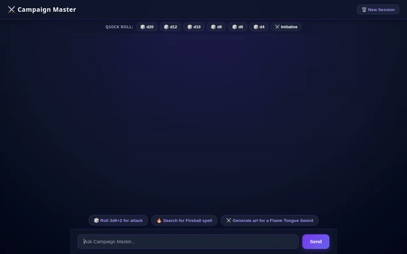

# ⚔️ Campaign Master Agent

An AI-powered Tabletop RPG & Dungeon Master assistant built with Google Agent Development Kit (ADK), Vertex AI, and Google Cloud services. Campaign Master helps players and Dungeon Masters manage campaign rules, generate item artwork and short videos, roll dice, search D&D 5e SRD reference databases, and execute custom Python calculations.



---

## 🌟 Features & Capabilities

### 🧠 Long-Term Memory (Vertex AI Memory Bank)
- Automatically remembers player preferences, campaign state, character details, and dietary/allergy sensitivities across sessions using **Vertex AI Memory Bank**.
- Preloads relevant user memories on session startup via `PreloadMemoryTool` and persists new interactions with session memory callbacks.

### 🎲 Interactive Sandbox & Dice Rolling Engine
- Evaluates dice notation (e.g., `3d6+2`, `1d20+5`, `4d6kh3`) for attacks, skill checks, and initiative.
- Executes complex numerical calculations inside a secure **Agent Engine Sandbox Code Executor**.

### 📖 D&D 5e Rules & SRD Reference
- Fetches official D&D 5e SRD spell stats and mechanics via the D&D 5e SRD REST API.
- Queryable campaign rules and spell mechanics.

### 🗄️ Firestore Campaign Database
- Persists custom monsters and spells into **Google Cloud Firestore** (`monsters` and `spells` collections).
- Enables querying and saving custom campaign assets on the fly.

### 🎨 Generative Media (Imagen 3 & Gemini Omni Video)
- **Fantasy Artwork Generation:** Creates visual artwork for items, spells, and monsters using Google **Imagen 3** (`imagen-3.0-generate-002`).
- **Short Video Generation:** Generates short animated fantasy videos using Google's **Omni model** (`gemini-omni-flash-preview`) in the `global` region.
- **Cloud Storage Asset Delivery:** Uploads generated images and videos directly to a public **Google Cloud Storage** bucket (`campaign-master-assets-141f75f249db`) and returns public HTTPS URLs.

### 🗺️ Geocoding & Local Gathering Places
- Geocodes physical tabletop session locations and discovers nearby local game stores or places using the **Google Maps Geocoding API**.

### 📱 Native A2UI Response Cards
- Formats structured agent responses into flat **A2UI** JSON components (Card, Column, Row, Text, Image) rendered natively in the custom web UI.

---

## 🏗️ Architecture

- **Agent Engine / ADK Core:** Built with `google-adk` Python framework.
- **Frontend Proxy:** Lightweight FastAPI backend (`frontend/main.py`) streaming agent queries over the A2A protocol.
- **Web Interface:** Custom dark-fantasy chat interface (`frontend/static/index.html`) featuring quick dice toolbar, example prompt chips, animated typing indicators, sender badges, and A2UI card renderer.

---

## 🚀 Local Setup & Execution

### Prerequisites
- Python 3.11+
- `uv` package manager (or standard `pip` / `venv`)
- Google Cloud SDK (`gcloud`) authenticated with a project containing Vertex AI APIs enabled

### Installation

1. Clone the repository and navigate to the project directory:
   ```bash
   cd campaign-master-agent
   ```

2. Install dependencies:
   ```bash
   uv sync
   ```

3. Set required environment variables:
   ```bash
   export GOOGLE_CLOUD_PROJECT="qwiklabs-gcp-01-141f75f249db"
   ```

### Running the Agent & Web UI Locally

1. **Start the FastAPI Proxy & Frontend:**
   ```bash
   cd frontend
   uv run python main.py
   ```

2. **Access the Web UI:**
   Open your browser to port `8080` on your local system to interact with Campaign Master.

---

## 📋 Status & Roadmap

- ✅ **Implemented:** Memory Bank, Firestore Database, Cloud Storage Asset Delivery, Imagen 3 Art Generation, Gemini Omni Video Generation, A2UI Cards, Dice Sandbox Executor, D&D 5e SRD Integration, Geocoding.
- ⏳ **Planned / Future Enhancements:** Voice synthesis for Dungeon Master narration, interactive combat turn order tracker widget.
